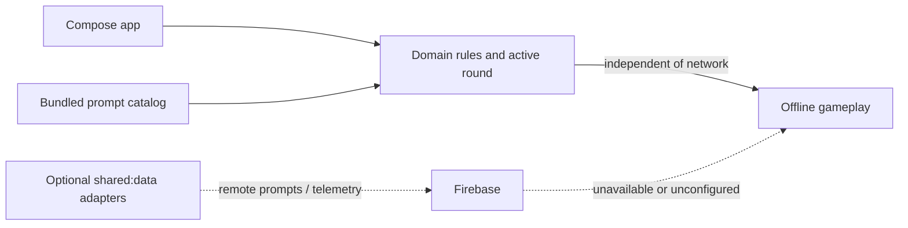

# ADR-0002: Optional Firebase integration behind local-first boundaries

## Status

Accepted. Android Google Services plugin application and iOS Firebase initialization/config copying are conditional on local configuration being present. Configuration-free on-device startup and gameplay have not been tested.

## Context

Impostor is an offline-first pass-and-play game. The bundled catalog, local setup, and an active round must work without a network connection, an account, or Firebase configuration. Firebase is an optional adapter for remote content and privacy-safe telemetry; it must not be a prerequisite for composing the app or starting/revealing a game.

## Decision

Keep gameplay and the bundled catalog offline-first. Firebase is optional and fail-safe:

- `shared:domain` owns `CodeRepository`, `AnalyticsService`, and the `ValidateCodeUseCase` contracts.
- `shared:data` owns cache-first code validation and the `RemoteCodeSource` / analytics platform seams.
- `composeApp` may compose domain contracts and data-layer adapters, but the Compose UI must never import or call Firebase SDKs directly.
- Remote operations are outside the local game-start/reveal path. An unavailable or unconfigured Firebase source must be represented as unavailable and must never prevent starting or completing a local game.
- Analytics may record event names and coarse non-sensitive values such as validation outcome. It must never include player names, prompt text, assignments, code values, or tokens.
- Firebase Analytics is an optional telemetry provider. Remote content is documented by ADR-0006; do not treat Firebase Remote Config as an adopted project dependency.

## Implementation status and verification

`composeApp/build.gradle.kts` applies the Google Services plugin only when `composeApp/google-services.json` exists. `iosApp/project.yml` copies `GoogleService-Info.plist` into the app bundle only when the file exists, and `iosApp/iosApp.swift` calls `FirebaseApp.configure()` only when that bundled plist exists. The app keeps the bundled catalog and local play paths available independently of Firebase; synced prompt refresh is detailed in ADR-0006.

This confirms conditional configuration wiring, not full runtime optionality. A no-configuration on-device Firebase startup/play test was not performed, nor was a separate full iOS host app build. Firebase adapter behavior when Firebase is unconfigured and when remote services are unavailable remains to be verified on device. The previously passing test/build command is recorded in `.serena/memories/testing_strategy.md`.

The former promo-code contract is not an entitlement source: ADR-0003 makes verified store state the only authority for Premium. Any retained code-related adapter must remain disconnected from subscription/category entitlement.

Before marking this decision fully verified, test Android and iOS startup/gameplay with Firebase configuration absent, Firebase unavailable, and network disabled. Confirm no Firebase initialization, analytics, or remote request can block the bundled catalog, local game start, or private reveal flow.

## Consequences

Conditional setup avoids requiring local Firebase configuration to build/configure the hosts, while the architecture keeps the local game independent of Firebase and avoids shipping privileged write credentials. Configuration-free runtime startup/gameplay and Firebase failure behavior remain explicit device-verification gaps.