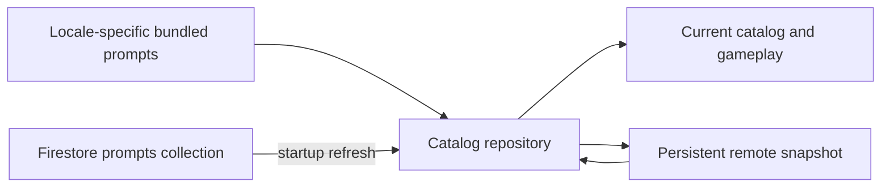

# ADR-0006: Offline-first prompt catalog with Firebase additions

## Status

Accepted.

## Context

The game loads its prompt catalog from a locale-specific bundled resource (`prompts-pl.json` or `prompts-en.json`). The catalog must remain available without network access. The app already uses Firebase Firestore for optional remote data, but has no persistent local database for prompts. New prompts should be distributable without an app release and remain available offline after a successful download. A remote failure must not interrupt gameplay or display an error to players.

## Options

1. Replace the bundled catalog with Firestore data. Rejected because first launch and offline play would depend on network availability.
2. Add a SQL database for the remote additions. Rejected for this feature because the data is a small read-only catalog and the project has no local SQL database.
3. Keep the bundle as the baseline, merge a Firestore collection into it, and persist the fetched additions through small platform-native preference adapters. Chosen to preserve offline startup without introducing a database dependency.

## Decision

- Keep the bundled catalog as the source of the built-in categories and prompts.
- Fetch active documents from a read-only Firestore `prompts` collection at app startup.
- Use a stable Firestore document ID and the fields `categoryId`, `text`, `hint`, and `active`; optional `locale` accepts `pl` or `en`. Missing `locale` defaults to Polish for backward compatibility. Only active, valid, locale-matched documents for categories known to the bundled catalog are eligible.
- Merge remote prompts additively by stable ID; do not remove or replace bundled prompts. Repeated syncs must not add duplicates.
- Persist a successfully fetched remote snapshot in platform-native preferences (Android `SharedPreferences`, iOS `NSUserDefaults`) through a data-layer abstraction. On startup, load the bundle plus the persisted snapshot immediately, then refresh from Firestore asynchronously.
- If Firestore is unavailable or the response is invalid, retain the last valid local snapshot and continue with the bundled catalog. Do not show an error message or block starting a game. Do not swallow coroutine cancellation.
- Keep Firestore access and persistence in `shared:data`; keep UI and domain free of Firebase and platform persistence APIs.
- Firestore clients have read-only access to `prompts`; administrators publish prompt documents through Firebase Console or a trusted server. The app contains no privileged write credential.

## Consequences

- First launch, offline startup, and failed remote refreshes continue to use the bundled catalog.
- Prompts fetched successfully once remain available offline after app restarts.
- New Firestore prompts appear in the catalog after the background refresh completes; an in-progress game remains unchanged.
- The read-only Firestore schema and security rules must be documented and configured before remote prompts can be used.
- The cached remote snapshot is stored as serialized catalog data in platform preferences; it must be validated before replacing the previous valid snapshot.
- Cached remote records retain their locale, so switching locales does not discard the other language's valid remote prompts.

## Follow-ups

- Document the Firestore prompt schema, publishing steps, and read-only rules in `docs/firebase.md`.
- Cover additive merge, invalid records, persistence, offline fallback, and cancellation using fakes; no unit test should make a real Firebase or platform-storage call.
- Verify Android and iOS builds after adding platform persistence adapters.
