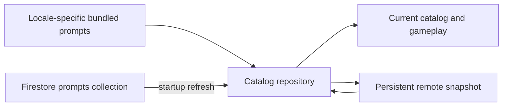

# ADR-0006: Offline-first prompt catalog with Firebase additions

## Status

Accepted. The app root uses the synced catalog with cached data and background refresh; latest same-locale/same-ID remote replacement, bundle precedence, single-category selection and legacy preference migration, and private accessible reveal behavior are implemented. Firebase configuration-free device behavior remains unverified; see ADR-0002.

## Context

The game loads its prompt catalog from locale-specific bundled resources. The catalog must remain available without network access. Firestore prompt additions are optional content, not a prerequisite for a game. New prompts should be distributable without an app release and remain available offline after a successful download. A remote failure must not interrupt gameplay or display an error to players.

## Options

1. Replace the bundled catalog with Firestore data. Rejected because first launch and offline play would depend on network availability.
2. Add a SQL database for the remote additions. Rejected for this feature because the data is a small read-only catalog and the project has no local SQL database.
3. Keep the bundle as the baseline, merge a Firestore collection into it, and persist the fetched additions through small platform-native preference adapters. Chosen to preserve offline startup without introducing a database dependency.

## Decision

- Keep the bundled catalog as the source of the built-in categories and prompts.
- Fetch active documents from a read-only Firestore `prompts` collection at app startup.
- Use a stable Firestore document ID and the fields `categoryId`, `text`, `hint`, and `active`; optional `locale` accepts `pl` or `en`. Missing `locale` defaults to Polish for backward compatibility. Only active, valid, locale-matched documents for categories known to the bundled catalog are eligible.
- Keep bundled prompts authoritative. Merge remote additions by `(locale, stable ID)`; never replace a bundled prompt. When a valid active Firestore document has the same `(locale, ID)` as a cached remote addition, the newest remote content replaces the cached content. Repeated syncs must not add duplicates.
- Preserve the existing additive behavior for omitted, inactive, or invalid remote records; removing cached remote content requires a separately specified deletion policy.
- Persist a successfully fetched remote snapshot in platform-native preferences (Android `SharedPreferences`, iOS `NSUserDefaults`) through a data-layer abstraction. At startup, load the bundle and cached snapshot before gameplay is available, then launch Firestore refresh in the background without blocking game setup or reveal.
- If Firestore is unavailable or the response is invalid, retain the last valid local snapshot and continue with the bundled catalog. Do not show an error message or block starting a game. Do not swallow coroutine cancellation.
- Keep Firestore access and persistence in `shared:data`; keep UI and domain free of Firebase and platform persistence APIs.
- Firestore clients have read-only access to `prompts`; administrators publish prompt documents through Firebase Console or a trusted server. The app contains no privileged write credential.
- Category setup supports selecting one category at a time. The selected ID is persisted through the existing set preference for compatibility, and an empty set can be stored; setup validation rejects an empty selection before a game starts. If an older saved set contains multiple categories, migrate to the first still-valid ID in bundled catalog order, not encoded or alphabetical order. If no saved ID remains valid, default to `animals` when available. When no set preference exists, continue migrating the legacy single-ID preference. The selected category filters the combined catalog.
- Role/prompt reveal remains private to the current pass-and-play player: only an explicit reveal interaction may expose that player's role/prompt, and release, loss of foreground, or player change returns the view to a covered state. Provide an accessible interaction and semantics without announcing the secret before it is revealed.

## Consequences

- First launch, offline startup, and failed remote refreshes continue to use the bundled catalog.
- Prompts fetched successfully once remain available offline after app restarts.
- New and updated Firestore additions appear after a background refresh; an in-progress game remains unchanged.
- The read-only Firestore schema and security rules must be documented and configured before remote prompts can be used.
- The cached remote snapshot is stored as serialized catalog data in platform preferences; it must be validated before replacing the previous valid snapshot.
- Cached remote records retain their locale, so switching locales does not discard the other language's valid remote prompts.
- The category selector presents one selected category at a time while retaining the set-shaped preference key. Setup rejects an empty selection, and setup and premium/trial checks evaluate the selected category.
- Reveal stays private across release, app backgrounding, player changes, and adaptive layouts; assistive technology has a usable reveal action but cannot read hidden content early.

## Implementation status

`ImpostorApp` constructs `syncedCatalogRepository()`, whose initial view combines bundled prompts with the persisted snapshot, and launches `refresh()` separately from local setup/gameplay. Refresh failures are logged and leave the usable local catalog in place. `SyncedCatalogRepository` replaces a cached remote record for the same locale and ID with the latest valid incoming record; bundled IDs remain authoritative.

Category selection is single-select. The set-shaped preference is read first for backward compatibility; multi-ID values are normalized to the first valid category in bundled catalog order and rewritten as a single-ID set, while the legacy single-ID key remains the fallback when no set value exists. The reveal screen exposes an accessible show/hide button and composes secret text only while reveal is active, the app is active, and the identity overlay is dismissed.

The passing test/build command is recorded in `.serena/memories/testing_strategy.md`; it includes the catalog, category-preference, reveal-logic, and shared entitlement regression tests. This is build/test evidence, not manual runtime testing. No no-configuration Firebase device test or separate full iOS host app build was performed.

## Follow-ups

- Document the Firestore prompt schema, publishing steps, and read-only rules in `docs/firebase.md`.
- Cover additive merge, invalid records, persistence, offline fallback, and cancellation using fakes; no unit test should make a real Firebase or platform-storage call.
- Keep regression coverage for same-ID remote replacement, bundled-ID precedence, locale separation, and omitted/inactive record retention.
- Keep regression coverage for single-category selection, catalog-ordered migration of legacy multi-ID preferences, combined catalog filtering, entitlement gating, and reveal visibility rules.
- Continue Android assembly and iOS framework-link checks with the documented Gradle command; a separate full iOS host app build remains unverified.
