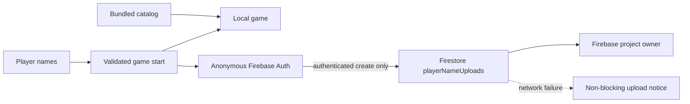

# ADR-0007: SEX category introduction, player-name uploads, and 18+ catalog

## Status

Accepted.

## Context

The local catalog has an active `adult` category displayed as `18+`, and a separate active `sex` category displayed as `SEX`. The bundled JSON is the shipped catalog source of truth; remote `prompts` are additive. The app already persists player names and category selection locally. Firebase Firestore currently serves read-only prompt data, while Analytics receives allowlisted event data.

The product request is to replace the `adult` prompts, introduce `SEX` to existing users once after updating, and make the names entered for a game available to the Firebase project owner. The user chose automatic upload without a separate confirmation and indefinite retention.

## Decision

### Catalog

- Replace only the prompts in category ID `adult` (display name `18+`) with the 50 supplied text/hint pairs.
- Preserve the `adult` ID, display name, icon, active status, and all other categories.
- Keep category ID `sex` and its existing prompts unchanged.
- Keep both categories in the bundled catalog so they are available offline.

### One-time category introduction

- Show a dismissible dialog describing only the new `SEX` category to existing installations when they first run the release that introduces the notice.
- Do not show the dialog on fresh installs.
- Use a persistent local marker so dismissing through **OK**, tapping outside, or system back prevents it from appearing again.
- Draw a low-contrast, non-explicit, clothed bust illustration behind the dialog content; do not add a remote image dependency.
- Keep the dialog in shared Compose UI and the marker behind the existing platform preferences boundary.

### Player-name upload

- On each valid game start, submit only the entered player-name list to a new Firestore `playerNameUploads` collection. Do not include prompt text, category, roles, device identifiers, or a game/session identifier.
- Authenticate the write using Firebase Anonymous Authentication. Firebase rules must permit authenticated creation only and deny client reads, updates, and deletes. The project owner can review records in Firebase Console.
- Store a server-generated creation timestamp for administration. Retain the records indefinitely as explicitly requested.
- Firebase/network failure must not prevent local gameplay; report the upload failure through a non-blocking UI message.
- Add the collection schema and required Firebase Console configuration/rules to `docs/firebase.md`. Update the published privacy policy to disclose the names, purpose, Firebase recipient, and indefinite retention.

## Data flow

## Consequences

- Gameplay remains local and playable offline; only the additional name upload depends on Firebase.
- Firestore client permissions become narrowly write-capable for authenticated creates, rather than read-only for every collection.
- Anonymous authentication must be enabled in the Firebase project. No client can read uploaded records through the app.
- Player names are personal data sent to Firebase and kept indefinitely; the privacy policy must reflect this before release.
- Firebase Console rules and product privacy disclosures are deployment responsibilities and cannot be changed by this repository alone.

## Validation

- Test that the `adult` catalog contains exactly the 50 supplied ordered pairs and the `sex` catalog remains unchanged.
- Test name payload construction and Firestore upload behavior through fakes; no Firebase network access in unit tests.
- Test one-time notice eligibility and all dismissal routes, including that fresh installs do not see it.
- Run shared data and app tests, Android debug build, and iOS simulator framework build.

## Follow-ups

- Enable Firebase Anonymous Authentication in the configured project.
- Publish Firestore rules for `playerNameUploads`; deny client reads, updates, and deletes.
- Update the relevant App Store and Google Play privacy/data-safety declarations before distributing the release.
- Consider enabling Firebase App Check in a separate deployment task to reduce automated abuse of anonymous writes.
