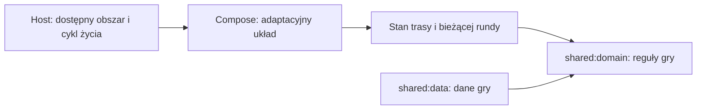

# ADR-0009: Responsywne ekrany i bezpieczeństwo rundy — iPhone Duo

## Status

Proposed. Plan został zatwierdzony; implementacja trwa niezależnie i nie została zweryfikowana w ramach tego ADR.

## Kontekst

Impostor jest grą pass-and-play: gracze kolejno oglądają poufne role na tym samym urządzeniu. UI powinno działać zarówno w małym, jak i w dużym dostępnym obszarze oraz bezpiecznie reagować na zmianę jego rozmiaru. Według [oficjalnej specyfikacji Apple](https://www.apple.com/iphone-duo/specs/) iPhone Duo ma ekran zewnętrzny 1398 × 2034 px i wewnętrzny 1878 × 2670 px. Wymiary ekranów nie są jednak wymiarami obszaru dostępnego aplikacji.

Proporcje istniejących projektów Figma są referencją wizualną, nie sztywnym rozmiarem układu. Lokalny Xcode udostępnia symulator iPhone Duo z iOS 27.3; jego dostępność nie oznacza, że aplikację na nim przetestowano. Sposób przekazywania aplikacji między ekranami wymaga weryfikacji.

W punkcie wyjścia [App.kt](../../composeApp/src/commonMain/kotlin/com/impostor/app/App.kt) zawiera ekrany Home, Players, Categories, Premium, Reveal i GameStart oraz dialogi i nakładki. Część układów ma sztywne wysokości lub nie przewija całej treści. Host iOS rozciąga Compose poza bezpieczny obszar ([iosApp.swift](../../iosApp/iosApp.swift)); bezpieczne marginesy, klawiaturę i dialogi należy zweryfikować łącznie.

Lokalne nagłówki publicznego UIKit w SDK iOS 27.2 potwierdzają `UIHinge` i `UIHingeInteraction` od iOS 27.1. `UIHinge.Status` obejmuje `unknown`, `closed`, `partiallyOpen` i `fullyOpen`; `angle` jest wyrażony w radianach. Aktualizacja może nie zawierać obiektu zawiasu, a częstotliwość i dokładność aktualizacji kąta zależą od systemu.

[ADR-0005](ADR-0005-rotation-state-restoration.md) opisuje odtwarzanie trasy i sesji oraz zasłonięcie roli po odtworzeniu. Istnieją funkcje serializacji sesji i ich test ([AppStateSaveable.kt](../../composeApp/src/commonMain/kotlin/com/impostor/app/AppStateSaveable.kt), [AppStateSaveableTest.kt](../../composeApp/src/commonTest/kotlin/com/impostor/app/AppStateSaveableTest.kt)), ale sam test serializacji nie potwierdza odtworzenia całej trasy przez host.

## Rozważone opcje

1. **Oddzielne układy według nazwy modelu lub rozdzielczości ekranów:** odrzucone — nawet znana specyfikacja nie określa bieżącego obszaru dostępnego aplikacji; rozwiązanie byłoby kruche.
2. **Jeden sztywny układ skalowany do każdego rozmiaru:** odrzucone — nie zapewnia czytelności, dostępności ani osiągalności akcji na małej wysokości.
3. **Wspólny układ adaptowany do dostępnego obszaru i bezpiecznie odtwarzany stan:** wybrana propozycja — obejmuje również inne urządzenia i nie zmienia zasad gry.

## Decyzja

### Układ i granice warstw

- Implementować adaptację przede wszystkim w `composeApp/commonMain`. Układ zależy od rzeczywistych ograniczeń kontenera, wysokości, safe area i klawiatury, a nie od nazwy urządzenia. Progi i maksymalną szerokość treści ustalić na podstawie czytelności i testów, nie specyfikacji sprzętu.
- Na małym obszarze zapewnić przewijanie, elastyczne wysokości i osiągalne akcje; kategorie przechodzą do jednej kolumny, gdy więcej kolumn nie pozwala na czytelne etykiety. Na szerokim obszarze ograniczyć i wyśrodkować szerokość treści; dodatkowe kolumny stosować tylko tam, gdzie pomagają.
- Objąć Home, Players z klawiaturą, Categories, Premium, Reveal, GameStart, dialogi i nakładki. Nie tworzyć układu odkrywania, który ujawnia rolę innym graczom.
- `shared:domain` pozostaje niezależne od rozmiaru i platformy; `shared:data` nie odpowiada za układ. Adapter platformowy wprowadzić tylko wtedy, gdy testy wykażą brak potrzebnych informacji lub obsługi cyklu życia w Compose. Integracja API zawiasu nie jest wymagana, jeśli wystarcza adaptacja do rozmiaru. Jeśli okaże się potrzebna, sprawdzać dostępność systemową i zachować działanie oparte na rozmiarze także przy braku danych lub statusie `unknown`. Nie zakładać konieczności zmiany ustawień orientacji lub pełnego ekranu.

### Stan i prywatność

- Przy samej zmianie rozmiaru zachować trasę, konfigurację oraz bieżącą sesję: identyfikator, hasło, przydziały, startera, ustawienie podpowiedzi i indeks gracza. Nie losować nowej rundy ani ponownie rozliczać jej rozpoczęcia.
- Przy odtworzeniu obsługiwanym przez host i mechanizm zapisu stanu stosować zasady [ADR-0005](ADR-0005-rotation-state-restoration.md): przywrócić trasę i sesję, a efekt startowy nie może nadpisać odtworzonej trasy. Zachowanie iOS przy odtworzeniu hosta wymaga osobnego potwierdzenia.
- Nie utrwalać stanu widoczności hasła ani trwającego gestu. Po odtworzeniu karta ma być zasłonięta i wymagać ponownego potwierdzenia tożsamości przed odkryciem. Po anulowaniu gestu, zmianie obszaru lub przejściu w tło rola musi zostać zasłonięta także wtedy, gdy kompozycja nie została odtworzona. Semantyka dostępności nie może ujawniać ukrytej roli.
- Nie wprowadzać trwałego zapisu aktywnej rundy na dysk ani obiecywać jej wznowienia po ubiciu procesu. Zakres wymaganego odtwarzania po pełnym odtworzeniu hosta pozostaje do potwierdzenia; niezależnie od tego nie wolno odtwarzać odkrytej roli.

## Konsekwencje

- Ten sam przepływ pozostaje współdzielony między platformami, ale wymaga testów różnych ograniczeń, klawiatury, cyklu życia i dostępności.
- Duży obszar nie musi być wypełniony rozciągniętymi kontrolkami; mały może wymagać przewijania.
- Odtworzenie sesji i zasłonięcie roli to oddzielne wymagania: reset animacji nie może resetować gry. Saveery nie dowodzą, że host rzeczywiście przywróci stan.
- Rzeczywista zgodność z konkretnym składanym urządzeniem pozostaje niepotwierdzona do testów na dostępnych narzędziach lub sprzęcie.

## Weryfikacja i dalsze kroki

1. Sprawdzić stan i bezpieczeństwo oddzielnie przy zmianie rozmiaru bez odtworzenia oraz przy odtworzeniu hosta: przed, w trakcie i po przytrzymaniu; po anulowaniu i przejściu w tło. Zweryfikować tę samą sesję, indeks i brak ponownego rozliczenia.
2. Przetestować pełny przepływ od Home do końca rundy oraz dialogi i Premium w syntetycznych obszarach, np. 240×320, 320×480, 420×800 i 700×600 dp. To dane testowe, nie parametry urządzenia. Sprawdzić granice wybranych progów, klawiaturę, długie imiona i hasła oraz PL/EN/UK.
3. Sprawdzić osiągalność akcji, brak obcinania, obszary dotyku co najmniej 48×48 dp, powiększony tekst — w tym docelowo 200%, gdzie wspiera to środowisko — oraz VoiceOver, fokus i dostępną alternatywę dla przytrzymania bez utraty prywatności.
4. Uruchomić odpowiednie testy jednostkowe, build Androida, framework i host iOS; wykonać regresję na obu platformach. Testy jednostkowe nie zastępują testów UI i hosta. Wybrać i skonfigurować wykonalny runner UI, jeśli potrzebny; do tego czasu uzupełnić pokrycie testami manualnymi.
5. Zmierzyć wydajność animowanego tła na dużym obszarze. Sprawdzić przepływ i zmiany obszaru w symulatorze iPhone Duo z iOS 27.3 w zakresie obsługiwanym przez symulator, a rzeczywiste przejście między ekranami także na urządzeniu, gdy będzie dostępne. Dopiero po zebraniu wyników rozważyć zmianę statusu tego ADR.
