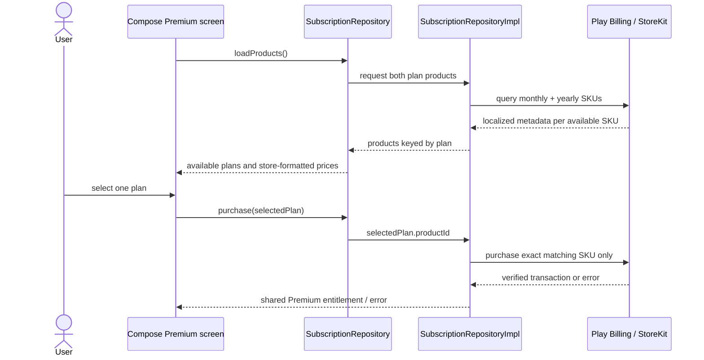

# ADR-0011: Distinct monthly and yearly Premium plans

## Status

Accepted. The yearly product identifier is selected, but neither store product is configured yet. Store setup and runtime implementation remain follow-ups.

## Context

The current Premium flow models a single product: `PremiumProductId` identifies the monthly SKU, `SubscriptionRepository` loads and purchases without a plan argument, and each platform adapter resolves that one SKU. The shared Compose screen displays one product. Premium access is already based on a verified store entitlement and must remain so.

The product decision is to offer two distinct billing plans:

| Plan | Product ID | Polish presentation target |
|---|---|---|
| Monthly | `com.impostor.app.premium.monthly` | `14,99 zł / Co miesiąc` |
| Yearly | `com.impostor.app.premium.yearly` | `59,99 zł / Co rok` |

The yearly identifier is a conventional code identifier chosen by the product owner. Products and prices have not yet been created in Google Play Console or App Store Connect. The shared UI should follow the supplied reference style/illustration and the existing dark navy, ice, and cyan visual language.

## Decision

Offer monthly and yearly as separate selectable plans in the shared Premium screen. Selection is explicit; a purchase request carries the selected domain plan through the repository to the platform adapter. No adapter may substitute another plan if the selected product is missing, unavailable, or fails to load. Disable purchase for a plan unless its matching store product and purchasable offer have been loaded.

The Polish screen target is exactly `14,99 zł / Co miesiąc` for monthly and `59,99 zł / Co rok` for yearly. These are intended store prices, not values to pass to a billing SDK or treat as proof of the eventual charge. After store products are configured, Google Play's formatted product price and StoreKit's localized display price are authoritative for the displayed price and checkout. Configure the stores to those target prices for the Polish storefront; if returned localized pricing differs, show the store value and resolve the configuration discrepancy rather than presenting a conflicting hard-coded charge. Do not start checkout with missing or stale product details.

Both plans grant the existing `premium_all_categories` entitlement. Keep entitlement state and reconciliation plan-agnostic: a verified, active purchase of either SKU unlocks Premium; cached state alone does not. Restore and current-entitlement queries must recognize both SKUs.

The yearly card displays the percentage saved against twelve monthly payments, calculated from store-provided prices in the same currency and rounded down to avoid overstating savings. Show no badge if either price or currency is unavailable, the periods are not exactly one month and one year, either offer has introductory pricing, or the yearly price is not cheaper. Never calculate from formatted text or assume a fixed price.

### Boundaries and responsibilities

- **Compose common UI** — In `composeApp/src/commonMain`, render two selectable plan options with localized period labels, selected state, store-formatted prices, and a purchase action bound to the selected plan. Retain the current restore/manage actions, loading/error handling, accessibility, and responsive layout. Add/update Compose string resources for Polish and the other supported locales. Keep the purchase action disabled when the selected offer is unavailable or a purchase/restore is already in progress.
- **Domain contract** — In `shared/domain`, add a stable monthly/yearly plan representation and associate each with its product ID. Change product loading to expose both available plan products and make purchase accept the selected plan (or an equally constrained typed product identity). Keep the contract free of Play Billing, StoreKit, and platform product types. Keep `PurchasePremiumUseCase` plan-aware. Product metadata carries store-formatted price/period for presentation; entitlement decisions remain shared and plan-independent.
- **Shared data orchestration** — In `shared/data`, load/cache product metadata by product ID, pass the exact selected plan to billing, and map verified purchases for either product to the same Premium entitlement. Preserve existing error, cancellation, pending, restore, and unavailable-store behavior.
- **Android** — The current Google Play Billing adapter is in `shared/data/src/androidMain`. Query both subscription products, associate each with its own returned `ProductDetails` and eligible offer token, and launch the billing flow only with the selected plan's details/token. Verify purchases against either known SKU and query both when reconciling/restoring. Never fall back to the monthly SKU when yearly was selected (or vice versa).
- **iOS** — The Kotlin notification adapter is in `shared/data/src/iosMain`; the StoreKit 2 host bridge is in `iosApp/iosApp.swift`. Load both products, return the requested product's localized metadata, and purchase only the `Product` matching the selected plan's product ID. Verify transaction updates, current entitlements, and restore against the allowlisted monthly/yearly IDs; both map to the same entitlement. Ignore unknown product IDs.

Configure both App Store products in the same `Impostor Premium` auto-renewable subscription group. Configure the annual product in Play using the selected yearly product ID and its annual billing period. Product setup, localized metadata, availability, pricing, review/testing, and Sandbox/license-tester verification are prerequisites to enabling checkout in release builds.

## Options considered

1. **Keep one SKU and vary its billing period through offers** — Rejected. The product requirement calls for distinct monthly and yearly products and the chosen annual identifier; a one-product offer model would not preserve that identity.
2. **Add yearly UI while retaining a no-argument purchase contract** — Rejected. A UI selection could be lost below the presentation layer, allowing the existing monthly-only adapters to purchase a different plan from the one selected.
3. **Carry an explicit typed plan through the domain contract and resolve exact store products in each adapter** — Selected. It makes selection observable and testable at every boundary while keeping store SDK types out of the domain.

## Consequences

- The existing single-product domain and data interfaces need a coordinated contract migration; UI selection alone is insufficient.
- Android and iOS may have different offer/base-plan details, but both must map to the same two stable product identities and entitlement.
- Store-localized price/period data avoids claiming a charge that differs from the purchase sheet. The requested Polish prices require matching store configuration before launch.
- Missing product configuration becomes a per-plan unavailable state, not permission to purchase the other plan.
- There is no new entitlement tier, Firebase dependency, or local-cache grant.
- Firebase Analytics records available products, explicit plan selection, and purchase start/result with an allowlisted `plan` value (`monthly` or `yearly`); it never receives store prices, product IDs, or transaction data.
- Changing an already-active subscription between plans (including Play replacement parameters and the desired upgrade/downgrade UX) is not inferred by this decision and needs explicit product/store-flow acceptance before implementation.

## Follow-ups

1. Create `com.impostor.app.premium.yearly` in Google Play Console and App Store Connect; configure monthly and yearly periods, Polish metadata, availability, and target Polish prices. Confirm the products' status and Apple subscription-group/Play base-plan setup.
2. Migrate domain, shared-data, Compose, Android Billing, and iOS StoreKit contracts as described above; ensure selection is passed to the actual purchase call with no fallback.
3. Add deterministic tests for both product mappings, per-plan availability, selected-plan propagation, unknown SKU rejection, and the invariant that a selected yearly plan cannot invoke monthly checkout (and vice versa).
4. Validate the Compose screen at supported window sizes and with accessibility services. On Polish storefronts verify the exact target labels and that store-returned prices match the purchase sheets.
5. Test each SKU on Play internal testing/license testers and App Store Sandbox: fresh purchase, pending/cancelled purchase, restore, renewal, expiry, revocation, and unavailable-product behavior. Verify both products reconcile to the same entitlement.
6. Decide separately whether and how an existing subscriber can switch monthly/yearly plans; test the platform-specific replacement/upgrade/downgrade behavior before claiming that flow is supported.

## Acceptance criteria

- In Polish, the configured monthly and yearly offers are shown as `14,99 zł / Co miesiąc` and `59,99 zł / Co rok`, with store-localized product pricing authoritative.
- Selecting monthly can only issue a purchase request for `com.impostor.app.premium.monthly`; selecting yearly can only issue one for `com.impostor.app.premium.yearly`. An unavailable selected SKU never triggers purchase of the other plan.
- A verified active purchase or restore of either SKU grants `premium_all_categories`; an unknown, pending, cancelled, expired, revoked, or unverified transaction does not.
- Product loading, restore, current-entitlement reconciliation, and verified StoreKit updates account for both product IDs.

## Flow

