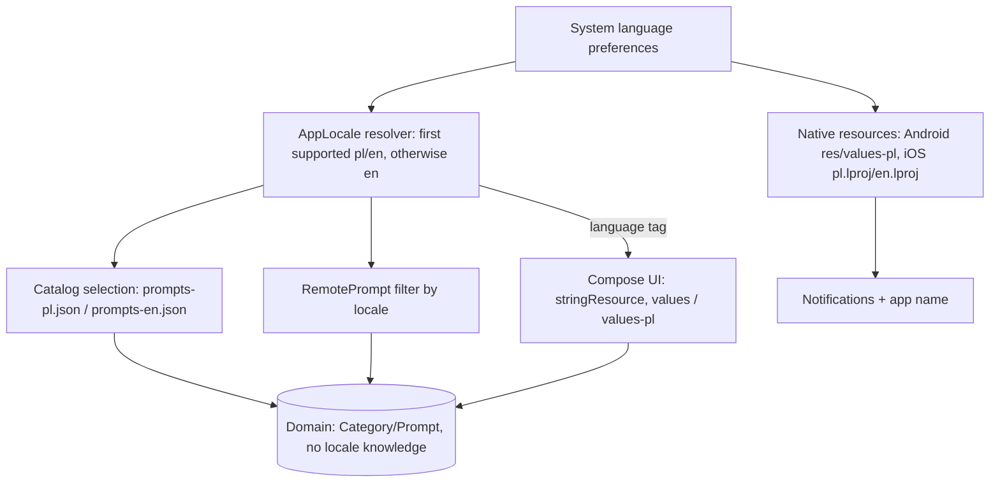

# Plan: English localization (Polish + English, system locale)

## Implementation status (2026-11-05)

Implemented: the shared locale resolver and tests, English/Polish Compose string resources, Android/iOS notification and app-name localization, and locale-aware remote prompt filtering with locale-preserving cache snapshots. The shipped Polish catalog was moved without content edits to `prompts-pl.json`; both platform loaders select by locale and safely fall back to Polish.

**Completed:** `prompts-en.json` contains all 1,321 prompts across the same 17 categories (1,221 active prompts). Category order, IDs, active category IDs, and prompt counts match the Polish bundle. English prompts carry translated text and explicit curated hints; proper names and established English loanwords are retained intentionally. No machine-translated catalog was generated. A JVM parity test verifies catalog structure, stable active prompt IDs, and nonblank English text and hints.

**Duplicate seed decision:** `docs/seed/prompts.json` is a historical copy only; `shared/data/src/commonMain/resources/seed/prompts-pl.json` is the authoritative shipped Polish catalog. The docs copy is intentionally left untouched.

## Goal and assumptions

The app follows the phone's language preferences: Polish stays exactly as today and English is added. Use the first preferred language supported by the app (`pl` or `en`); if none is supported, use English. All user-visible text is translated: UI, notifications, app name, and the game words.

- **Assumption ("hasła")**: the user's "hasła" means the game words/prompts, not account passwords. Evidence: the Polish seed catalog now lives at `shared/data/src/commonMain/resources/seed/prompts-pl.json` (categories of words such as "Pingwin" with a hint), and the in-app rules say "poznać swoją rolę i hasło". The app has no passwords or accounts.
- **Fallback (default proposed)**: inspect preferred languages in order and use the first `pl` or `en` entry; if neither appears, use English. For example, `[de, pl]` resolves to Polish and `[de]` resolves to English. Existing Polish users see no change.
- **Out of scope**: an in-app language picker, RTL, plural/gender grammar beyond what the current strings need, store listings, `docs/*.html` (privacy/support), Firestore backfill of English prompts (only the schema is prepared, in phase 4).

## Current state (evidence)

| Area | Where text lives today | Notes |
|---|---|---|
| UI (home, rules, players, reveal, premium/paywall, settings errors) | Hardcoded Polish literals in a single file, `composeApp/src/commonMain/kotlin/com/impostor/app/App.kt` (1579 lines, ~30 lines with Polish diacritics, e.g. L354 "GRA IMPREZOWA", L383 "Ustawienia wymagają uwagi: ${error.name…}", L521-525 "JAK GRAĆ" rules, L1095 "Wpisz imię gracza...") | No `stringResource` usage, no `Locale` code anywhere (grep). `composeApp/src/commonMain/composeResources/` has only `drawable` and `files`. |
| Settings errors | `App.kt:383` builds text from an enum name (`error.name.lowercase()`), so it is not translatable as is | Needs an enum→string-resource mapping. |
| Paywall/premium | Literals in `App.kt`; domain `SubscriptionProduct` (`shared/domain/.../Subscription.kt`) carries `title`, `formattedPrice`, `periodLabel` from the stores | Store-supplied strings are localized by the stores. `periodLabel` must be checked in the billing code. |
| Notifications | Android: `composeApp/src/androidMain/kotlin/com/impostor/app/PartyReminderReceiver.kt:19-20,83` ("Impreza?", "Zagraj ze znajomymi w Impostora!", channel "Zaproszenia do gry"). iOS: `composeApp/src/iosMain/kotlin/com/impostor/app/NotificationScheduler.ios.kt:21-22` (same literals, `UNNotificationRequest`) | Native code, outside Compose resources. The common interface is `NotificationScheduler.kt`. |
| App name | Android `AndroidManifest.xml:8` `android:label="Impostor"`; iOS `iosApp/Info.plist` `CFBundleDisplayName` = "Impostor"; `CFBundleDevelopmentRegion` = `$(DEVELOPMENT_LANGUAGE)` | Name is the same in both languages. Should still move to resources. |
| Game words/categories | `shared/data/src/commonMain/resources/seed/prompts-pl.json` and `prompts-en.json` (schemaVersion 1, 17 categories, `name` + `prompts`). Plain-string prompts get ids `<category>-NNN` by **index** (`SeedCatalogRepository.kt` `toSeedPrompt`); object prompts can carry explicit `{text, hint}` data. `fantasy` is defined but inactive. | The English bundle uses explicit translated hints for every prompt. Both platform loaders retain a Polish fallback if the English resource is missing or invalid. |
| Duplicate seed | `docs/seed/prompts.json` differs from the shipped file | Historical copy only; do not treat as authoritative or overwrite it in localization changes. |
| Remote prompts | `FirestorePromptSource` reads optional `locale` from collection `prompts`; missing locale is Polish. | Remote records are filtered by app locale and snapshots retain locale. |
| Persisted state | Category selection (`CategoryPreferences*.kt`) and saved game state (`AppStateSaveable.kt`, ADR-0005) are keyed by category/prompt id | Ids must stay identical across locales. |
| Tests | `SeedCatalogRepositoryTest`, `BundledCatalogRepositoryTest`, `SyncedCatalogRepositoryTest`, `AppStateSaveableTest`, `GameDomainTest` contain Polish assertions | Per `testing_strategy`, tests live in `commonTest`/`jvmTest`. |

### UI and native string key inventory

| Key family / resource | Scope |
|---|---|
| `home_*`, `validation_*` | Home labels and explicit setup-validation error mapping |
| `rules_*`, `sex_*`, `role_*`, `reveal_*`, `game_*` | Rules overlay, category notice, role reveal, and game start |
| `players_*`, `default_player`, `categories_*` | Player management, category screen, trial messaging |
| `premium_*`, `subscription_*`, `purchase_*`, `period_*` | Paywall, store state/errors, billing periods |
| Android `app_name`, `party_reminder_*` | Launcher label, notification channel, notification title/body |
| iOS `CFBundleDisplayName`, `party_reminder_*` | Launcher label and scheduled notification title/body |

## Target architecture

Boundaries:

- **Domain** stays locale-free (`Category`, `Prompt` are already plain data). The locale resolves only in the data and presentation layers.
- **`AppLocale` resolver**: small pure function `resolveLocale(preferredTags: List<String>): AppLocale` in `commonMain`, plus a one-line `expect/actual` for the platform tag list. The resolver takes the first preferred tag whose language is `pl` or `en`, otherwise defaults to English. Pure → unit-testable.
- **UI strings**: Compose Multiplatform resources (`composeResources/values/strings.xml` for the default and `values-pl`). Compose resolves them per the system locale itself, so the picked default must match the fallback rule. Confirm that the resource default (no qualifier) is English, with `values-pl` for Polish.
- **Native text** (notifications, app name): platform resources, because the receiver/scheduler run without Compose.
- **Words**: separate bundled files per locale with identical ids and category ids. Locale changes affect only the displayed text.
- No ADR is needed: this follows established patterns (shared-first, domain without infra). Write one only if phase 4 changes the Firestore schema in an incompatible way.

## Phases (each builds and ships independently)

### Phase 0 – Audit
- Inventory all string literals in `App.kt` and the billing code (`periodLabel`, errors), and list them in a key table.
- Keep all categories available in English by default. Translate category names, prompt text, and hints; retain proper names where they have no natural English equivalent.
- Acceptance: the list of keys and the catalog translation scope are recorded here.

### Phase 1 – Locale resolver and UI string externalization (Polish unchanged)
- Add `AppLocale` and resolver plus unit tests.
- Move every literal in `App.kt` into `strings.xml` (`values-pl` gets the exact current text; `values` gets English). Replace the enum-name error text at L383 with a mapping to resource keys. Use named format arguments for `${…}` strings.
- Acceptance: with the device in Polish, screens are pixel/text identical to today. With English, all UI text is English. No Polish literals remain in `commonMain` UI (grep check).

**Status:** Implemented for Compose strings, error/state mapping, billing period labels, and default player labels. Logo/brand and non-user-facing technical strings remain literals.

### Phase 2 – Native text: notifications and app name
- Android: `res/values/strings.xml` + `res/values-pl/strings.xml` for channel name, title, body, and `app_name`. Read them in `PartyReminderReceiver` through `context.getString`. Because the notification text is set at fire time (not schedule time), Android picks up the current language. Add `android:localeConfig` / `res-config` so the per-app language setting lists pl and en.
- iOS: `en.lproj` + `pl.lproj` with `Localizable.strings` and `InfoPlist.strings`. Add `knownRegions` / `CFBundleLocalizations` in `iosApp/project.yml` and `Info.plist`. iOS schedules notifications ahead of time (`party-reminder-$index`), so the text is fixed at the language of the schedule moment. Reschedule on app foreground so a language change gets picked up.
- Acceptance: a notification fires in the current device language on both platforms. The app name is correct in both.

**Status:** Resources and foreground rescheduling are implemented; device-level notification and app-name checks remain manual.

### Phase 3 – Localized bundled catalog
- Split the seed into `prompts-pl.json` (today's content, moved without edits) and `prompts-en.json` (translated names, words and hints). Keep category ids and `<category>-NNN` ids identical, and keep the order. Add a per-locale hint map or inline `{text, hint}` for all English words. Do not translate by simple word-for-word where the Polish hint chain is meaningless; English hints are curated.
- `BundledCatalogRepository` actuals select the file by `AppLocale` (Android assets, iOS bundle, JVM classpath). The loader falls back to Polish if the English file is missing or cannot be parsed (defence in depth).
- Make `activeCategoryIds` per-locale only if product rules require it; otherwise keep the same categories available in both locales. For Polish-specific celebrity categories, retain the names and translate the hints.
- Acceptance: both catalogs parse. Same set of shared category ids and prompt ids (test). Every prompt has a non-blank hint. No duplicates in a category. An existing saved selection/game state still resolves after switching language.

**Status:** Complete. The Polish catalog remains unchanged. The English catalog translates all category names, ordinary prompts, and explicit hints; established names and loanwords are retained where appropriate. The iOS resource-copy phase includes both locale bundles. `SeedCatalogParityTest` checks category order and IDs, active IDs, per-category prompt counts, stable active prompt IDs, and nonblank names, text, and hints.

### Phase 4 – Remote prompts and catalog sync by locale
- Add optional `locale` to `RemotePrompt` (missing = `pl`, preserving existing documents). `SyncedCatalogRepository` includes only prompts matching the current locale, and the snapshot cache stays valid.
- Acceptance: English users never see untagged (Polish) remote words. Polish behavior is unchanged. Update ADR-0006 notes only if the schema change is significant.

**Status:** Implemented. Snapshot schema v2 stores locale and still reads v1 snapshots as Polish.

### Phase 5 – Verification and docs
- Update tests, `docs/`, and the Serena memories (`ui_architecture`, `data_strategy`) with the localization convention. Decide on the stale `docs/seed/prompts.json`.

**Status:** Localization docs and the two relevant memories are updated. The historical docs seed is explicitly not authoritative.

## Acceptance criteria (overall)

1. Preferred languages `[pl, …]` → Polish; `[en, …]` → English; unsupported-only preferences (e.g. `[de]`) → English. If preferences are `[de, pl]`, use Polish, the first supported language.
2. No user-visible Polish remains in English mode (UI, notifications, categories, words, hints, error messages, paywall).
3. Category and prompt ids are identical across locales; saved preferences survive a language change.
4. Android and iOS both covered; the JVM target (tests) still builds.
5. No new Firebase calls from UI/ViewModels, and domain has no locale dependency.

## Test and verification strategy

- **Unit (`commonTest`/`jvmTest`)**: resolver cases (`pl-PL`, `en-GB`, `de`, empty list, list `[de, pl]`); catalog parity test (ids, counts, hints, no blank text); remote locale filtering incl. missing field; existing tests keep passing with the Polish default.
- **Lint-style check**: grep/test that `App.kt` has no diacritic literals after phase 1.
- **Commands** (see `suggested_commands`, `task_completion_checklist`): run the shared module tests, `:composeApp` Android build, and the iOS framework/simulator build.
- **Manual**: on Android emulator and iOS simulator, switch the system language between Polish, English and German; check home, rules, players, reveal, premium, settings error, a notification (shorten the schedule for the test), the launcher name; play a game with each category. Switch language mid-session, relaunch, and confirm the saved state still loads.
